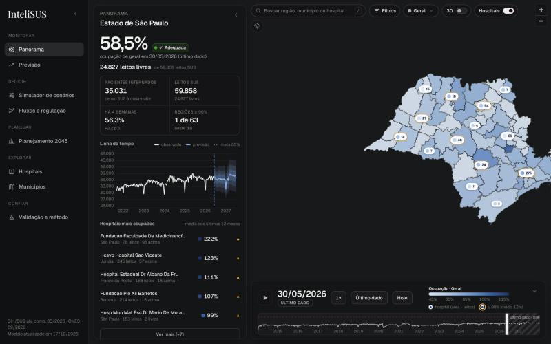

# InteliSUS

**A digital twin of the SUS hospital network in São Paulo state** (*gêmeo digital da rede hospitalar do SUS*)

[](LICENSE)


InteliSUS rebuilds, from official open data, how many patients were hospitalized in each hospital on
each night since 2014. It then syncs the state to the most recent data, propagates it to today, and
projects it forward with calibrated uncertainty. Health managers can use it to **monitor** occupancy,
**forecast** it, **simulate** decisions, and **plan** the network.

<p align="center">
  
</p>

<p align="center"><i>63 health regions · 17 regional health departments · 645 municipalities · 807 hospitals · 7 bed types · 30 million hospital admissions</i></p>

## What the dashboard answers

| View | Question |
| --- | --- |
| **Overview** | How full was each region on the last day with data? Who is at risk in the next four weeks? |
| **Forecast** | What occupancy is expected day by day, with 50/80/95% intervals? How likely is it to pass 85% or 100% in each week? |
| **Scenario simulator** | What if a respiratory epidemic hits? What if primary care avoids 20% of ambulatory-care-sensitive admissions, length of stay drops 5%, 100 beds open, or regional regulation is switched on? |
| **Flows and regulation** | Where do patients come from and go to? Which regions depend on others? |
| **Planning 2045** | How many beds, of which type, will population aging require in each region? |
| **Hospitals and municipalities** | Occupancy, attraction, and size of each hospital; age-standardized rates for each municipality. |
| **Validation and method** | How wrong is the twin? Are the intervals calibrated? What are the limits? |

## Run it

The exported data is committed, so the dashboard runs without downloading anything.

```bash
make setup      # Python 3.11+ environment and the web app (Node 20+)
make web        # dashboard at http://localhost:5190
make test       # engine tests in Python and TypeScript, with a parity check between the two
```

To rebuild the data from the sources:

```bash
make baixar ATE=2026-08 CNES=2026-09   # download SIH and CNES from DATASUS (about 3 GB cache)
make pipeline                          # about a minute: stages 0 to 7, writes web/public/data/*.json
```

Downloads use PySUS 0.9 in a separate Python 3.9 environment. Point `PYSUS_PY` at it (default
`python3.9`) and set `PYSUS_CACHEPATH` to choose where files are cached (default `~/pysus`).
`make atualizar` checks DATASUS for new months, downloads them, validates the files, reruns the
pipeline and tests, and rolls back if anything fails. See [`docs/ATUALIZACAO.md`](docs/ATUALIZACAO.md).

## How it works

```
DATASUS (SIH RD, CNES LT) ─┐                    pipeline/gemeo (Python, DuckDB, NumPy)
IBGE (Census 2022, Proj.) ─┼─► p00 validation ─► p01 consolidation ─► p02 territory ─► p03 capacity
CNES API (names, coords) ──┘        │
                                    ▼
          p04 daily census + completeness ─► p05 calibration/backtest/forecast ─► p06 analyses ─► p07 export
                                                                                                   │
web/ (React, MapLibre, ECharts) ◄── JSON ◄─────────────────────────────────────────────────────────┘
   ├─ engine/motor.ts      M_t/G/∞ propagation (same algorithm as the Python engine, parity-tested)
   └─ engine/simulador.ts  Monte Carlo scenarios with regulation, in a Web Worker
```

1. **Reconstructed census.** Each hospital admission record (AIH, type 1, deduplicated) becomes up to
   two occupancy segments: ICU (ICU days at the start of the stay) and ward (bed type from the
   specialty). The midnight census follows from cumulative sums of entries and exits.
2. **Honest sync.** An AIH only arrives after discharge, with a delay of one to three months. The
   completeness curve is estimated by comparing what was known at six historical cutoffs with what
   arrived later. The twin's state is fixed at the last day with at least 97% of the census billed.
3. **Arrivals.** λ(t) = recent level (84 days) × day of week (per region) × seasonality (Fourier) ×
   holidays × phase of the month.
4. **Length of stay.** A daily discharge hazard h(a,t) = h₀(a) · m(calendar), estimated with
   Kaplan–Meier with censoring at the origin and a separable effect of day of week, phase of the
   month, and holiday. This captures the discharges concentrated at the end of the billing month.
5. **Propagation.** Beds as infinite servers (M<sub>t</sub>/G/∞), as in the Dutch COVID-19 hospital
   digital twin of Baas et al. (2021), with exact mean and variance per cohort.
6. **Scenarios.** Daily Monte Carlo with capacity, regulated overflow to the nearest region,
   respiratory waves, aging (IBGE 2024), primary care, length of stay, and beds. The base case and
   each scenario share random numbers.

The full method is in [`docs/METODOLOGIA.md`](docs/METODOLOGIA.md) (in Portuguese).

## Validation

Out of sample, over 25 monthly forecast origins from 2024 to 2026, with profiles fitted only on data
up to 2023. WAPE of **regional** occupancy (state-level in parentheses):

| Bed type | 7 days | 30 days | 90 days | Persistence (30 d) | 80% interval coverage |
| --- | --- | --- | --- | --- | --- |
| Clinical | 5.1% (2.3%) | 7.1% (2.3%) | 7.2% (1.9%) | 10.0% | 82–86% |
| Adult ICU | 7.6% (1.6%) | 9.0% (2.5%) | 9.1% (2.7%) | 10.7% | 86–89% |
| Surgical | 6.8% | 8.6% | 8.6% | 20.8% | 85–87% |

In operating conditions (17 billing cutoffs, using only the AIHs that existed at each cutoff, with
"today" set 56 days after the last billed data), the regional error of "today" is 6.6% for clinical,
8.3% for adult ICU, and 8.2% for surgical beds. A naive baseline errs by 9.8%, 10.7%, and 23.2%.

## Data and limits

- **SUS only.** The data covers SUS hospital admissions (SIH/SUS) and SUS beds (CNES). It does not
  include the private network or admissions that are not billed through an AIH.
- **Long-stay AIHs** (type 5) are excluded, so psychiatry and chronic care have low reliability.
- SIH has no ICU dates, so ICU days are placed at the start of the stay.
- Hospital occupancy can exceed 100% when an AIH of one specialty is billed in a bed of another. At
  the regional level this evens out.
- Today's state is propagated from the sync date (about five months old). Closing the loop in real
  time would need a daily hospital census, such as the one held by the state's regulation center.

### Sources

| Source | Use |
| --- | --- |
| [SIH/SUS](https://datasus.saude.gov.br/) (DATASUS), Jan 2014 to Aug 2026 | admissions, dates, specialty, ICU, diagnosis, residence |
| [CNES](https://cnes.datasus.gov.br/) (DATASUS) | SUS beds by facility and type; names and coordinates of hospitals |
| [IBGE](https://www.ibge.gov.br/) Census 2022 (SIDRA 9514) and Projections 2024 | population by age group and municipality, growth to 2045 |
| IBGE maps | municipality and health-region boundaries |

All of these are public. The repository includes the small IBGE and CNES files the pipeline needs in
`data/external/` and `data/raw/`, and the aggregated results the dashboard reads in
`web/public/data/`. It contains no patient-level data.

## Layout

```
pipeline/      Python pipeline (DuckDB, NumPy) and the DATASUS download and update scripts
web/           React, MapLibre, and ECharts dashboard, with the engine mirrored in TypeScript
tests/         engine tests in Python (the TypeScript tests live in web/src/engine)
docs/          method (METODOLOGIA.md) and update procedure (ATUALIZACAO.md)
data/          small public inputs (IBGE maps and projections, CNES and SIDRA extracts)
```

## License

[MIT](LICENSE). The data sources keep their own terms.
